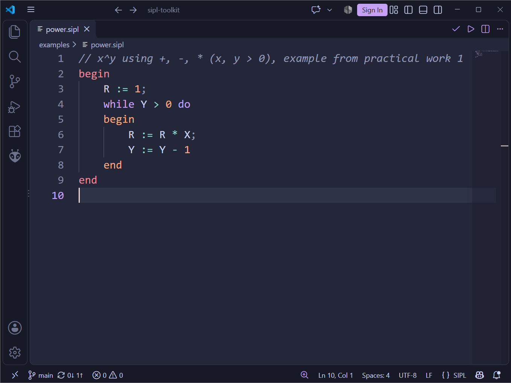
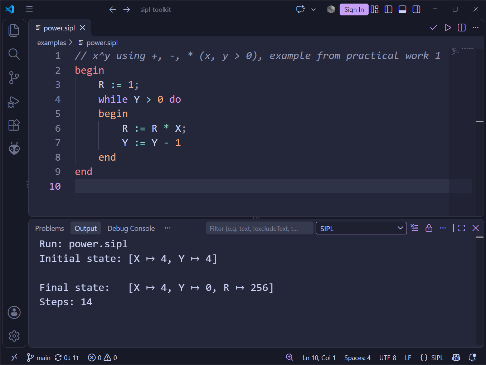
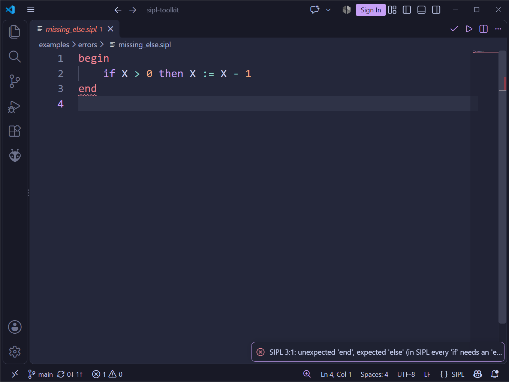

# SIPL Language Support for VS Code

Client for the [SIPL Language Toolkit](https://github.com/exite-off/sipl-toolkit).
The language itself (parser, interpreter, semantic terms) lives in the Python package `sipl-kit`;
the extension calls `sipl ... --json` and shows the results.

## Features

- `.sipl` files: syntax highlighting, `//` and `/* */` comments, `begin`/`end` bracket matching, auto indent
- snippets: `program`, `while`, `if`, `begin`, `assign`, `power`
- **SIPL: Run** (Ctrl+F5 or the ▶ button) asks for the initial state (`X=5, Y=2`) and prints the final state
- **SIPL: Check** shows syntax errors with exact line and column; files are also checked while typing
- **SIPL: Trace** prints every execution event (assign, condition, before/after statement)
- **SIPL: Show Semantic Term** prints the term in course notation with all applied rules

## Requirements

- VS Code 1.85 or newer
- Python 3.10+ with the toolkit installed: `pip install sipl-kit`

The extension looks for Python with `sipl-kit` by itself: `py -3`, `python`, `python3`, `sipl` on Windows,
`python3`, `python`, `sipl` elsewhere. If none works (for example `python` opens the Microsoft Store on Windows),
set `sipl.pythonPath` (for example `C:\\Users\\me\\sipl\\.venv\\Scripts\\python.exe`).

## Settings

| Setting | Default | Meaning |
|---|---|---|
| `sipl.pythonPath` | empty: search | interpreter with `sipl-kit` installed |
| `sipl.cliPath` | empty | path to the `sipl` executable, used instead of `python -m sipl` |
| `sipl.maxSteps` | 100000 | step limit for Run/Trace |
| `sipl.checkOnType` | true | live syntax check |

## Install from release

Download `sipl-vscode-<version>.vsix` from GitHub Releases, then
`code --install-extension sipl-vscode-<version>.vsix` or Extensions → `...` → Install from VSIX.
